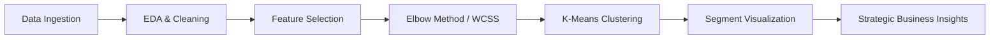

# 🛍️ Customer Segmentation Using K-Means Clustering

[](https://www.python.org/)
[](https://scikit-learn.org/)
[](https://pandas.pydata.org/)
[](https://matplotlib.org/)
[](https://youtu.be/1ayBLuL52aQ)

> **An unsupervised machine learning project that segments mall customers based on their annual income and spending score using K-Means clustering, unlocking data-driven marketing strategies and customer persona insights.**

---

## 📺 Project Demo Video

Watch the complete project walkthrough and code execution demo on YouTube:

[](https://youtu.be/1ayBLuL52aQ)

▶️ **[Click here to watch the project demo on YouTube](https://youtu.be/1ayBLuL52aQ)**

---

## 📌 Table of Contents
- [Project Overview](#-project-overview)
- [Demo Video](#-project-demo-video)
- [Key Features](#-key-features)
- [Dataset Overview](#-dataset-overview)
- [Methodology & ML Workflow](#-methodology--ml-workflow)
- [Results & Customer Segments](#-results--customer-segments)
- [Business Insights & Marketing Strategies](#-business-insights--marketing-strategies)
- [Project Structure](#-project-structure)
- [How to Run](#-how-to-run)
- [Tech Stack](#-tech-stack)
- [Author](#-author)

---

## 🎯 Project Overview

In retail and commercial environments, customer behavior varies significantly. One-size-fits-all marketing campaigns often result in low engagement and wasted advertising budget. 

This project implements an **unsupervised K-Means clustering algorithm** to segment retail customers based on their **Annual Income** and **Spending Score**. By grouping customers into distinct behavioral clusters, businesses can formulate customized, data-backed marketing strategies to maximize customer retention, satisfaction, and revenue.

---

## ✨ Key Features

- **Exploratory Data Analysis (EDA):** Statistical summary and validation checking for missing and duplicate values.
- **Elbow Method Optimization:** Determination of optimal cluster count ($K$) using Within-Cluster Sum of Squares (WCSS).
- **K-Means Clustering:** Robust unsupervised partitioning of customer records.
- **Visual Analytics:** Intuitive 2D scatter plots of customer segments and cluster population distributions.
- **Data-Driven Strategy Formulation:** Practical marketing and engagement recommendations tailored for each identified customer segment.
- **Automated Results Export:** Output saved to CSV (`Customer_Segmentation_Results.csv`) for downstream reporting and CRM integration.

---

## 📊 Dataset Overview

The dataset represents shopping mall visitor transaction and demographic profiles.

- **Total Records:** 200 customers
- **Source:** Mall Customers Dataset (`archive.zip`)

| Feature Name | Type | Description |
| :--- | :--- | :--- |
| `CustomerID` | Numeric (Integer) | Unique identifier assigned to each customer |
| `Gender` | Categorical | Customer gender (Male / Female) |
| `Age` | Numeric (Integer) | Customer age in years |
| `Annual Income (k$)` | Numeric (Float/Int) | Annual earnings of customer (in thousands of USD) |
| `Spending Score (1-100)` | Numeric (1-100) | Score assigned by mall based on customer behavior and spend |

> **Clustering Features:** `Annual Income (k$)` and `Spending Score (1-100)` are selected for multi-dimensional customer segmentation.

---

## ⚙️ Methodology & ML Workflow



1. **Data Ingestion & Inspection:** Loaded dataset, validated dimensions (200 rows × 5 columns), and verified data integrity.
2. **Data Cleaning & Verification:** Confirmed 0 null/missing values and 0 duplicate records.
3. **Feature Selection:** Filtered target feature subset: `Annual Income (k$)` and `Spending Score (1-100)`.
4. **Finding Optimal Clusters ($K$):** Iterated $K \in [1, 10]$ and computed inertia (WCSS) to construct the Elbow curve.
5. **Model Training:** Fitted `KMeans` with the chosen cluster count (`random_state=42`, `n_init=10`).
6. **Cluster Tagging & Analysis:** Assigned segment labels back to original customer records and computed aggregate metrics.
7. **Export & Visualization:** Visualized customer clusters with scatter plots and exported `Customer_Segmentation_Results.csv`.

---

## 📈 Results & Customer Segments

The analysis partitions the customer base into four primary distinct behavioral segments:

### Segment Distribution

| Customer Segment | Customer Count | Percentage | Profile Summary |
| :--- | :---: | :---: | :--- |
| **Low Income — High Spending** | 52 | 26% | High propensity to spend despite modest income |
| **High Income — Low Spending** | 50 | 25% | High purchasing capacity with conservative spending habits |
| **High Income — High Spending** | 50 | 25% | Ideal high-value, high-engagement customer base |
| **Low Income — Low Spending** | 48 | 24% | Budget-conscious shoppers focused on essential value |

---

## 💡 Business Insights & Marketing Strategies

```
             High Spending (1-100)
                    ▲
                    │
      [Trendsetters]│   [Prime VIPs]
      Low Income    │   High Income
      High Spending │   High Spending
                    │
◄───────────────────┼───────────────────► Annual Income (k$)
                    │
      [Frugal]      │   [Conservative]
      Low Income    │   High Income
      Low Spending  │   Low Spending
                    │
                    ▼
              Low Spending
```

### 1. 💎 High Income — High Spending *(Prime VIPs)*
- **Customer Behavior:** Affluent, loyal, and willing to spend on premium products.
- **Recommended Action:**
  - Provide exclusive VIP membership programs and dedicated concierge support.
  - Offer early access to limited-edition merchandise and premium luxury lines.
  - Host private shopping events and personalized perks.

### 2. 🎯 High Income — Low Spending *(Conservative / High Potential)*
- **Customer Behavior:** High financial capability, but infrequent purchases or price-sensitive in this store.
- **Recommended Action:**
  - Survey pain points to understand hesitation or dissatisfaction.
  - Deploy targeted marketing highlighting product quality, warranty, and brand value.
  - Offer attractive bundle incentives and introductory discounts on premium tiers.

### 3. 🛍️ Low Income — High Spending *(Trendsetters / Enthusiasts)*
- **Customer Behavior:** Younger or trend-focused shoppers who prioritize lifestyle spending over income constraints.
- **Recommended Action:**
  - Introduce flexible financing options such as "Buy Now, Pay Later" (BNPL).
  - Launch flash sales, influencer collaborations, and rewards programs.
  - Provide budget-friendly alternatives that emulate luxury trends.

### 4. 🏷️ Low Income — Low Spending *(Frugal / Budget-Conscious)*
- **Customer Behavior:** Highly cautious shoppers focused strictly on necessity and affordability.
- **Recommended Action:**
  - Offer discount coupons, seasonal clearance sales, and everyday low-price guarantees.
  - Promote loyalty stamp cards to encourage repeat store visits.
  - Highlight cost-effective utility and bulk purchase savings.

---

## 📂 Project Structure

```bash
Customer_segmentation_KMeans/
│
├── Customer_Segmentation_KMeans.ipynb   # Main Jupyter/Colab notebook with analysis & code
├── Customer_Segmentation_Results.csv    # Clustered dataset containing segment classifications
├── archive.zip                          # Compressed raw dataset archive
└── README.md                            # Comprehensive project documentation
```

---

## 🚀 How to Run

### Option 1: Run in Google Colab (Recommended)
1. Navigate to [Google Colab](https://colab.research.google.com/).
2. Upload `Customer_Segmentation_KMeans.ipynb`.
3. Upload `archive.zip` or the dataset when prompted.
4. Run all notebook cells sequentially (`Runtime` ➔ `Run all`).

### Option 2: Run Locally via Jupyter Notebook

1. **Clone the repository:**
   ```bash
   git clone https://github.com/avanthiga0630/Customer_segmentation_KMeans.git
   cd Customer_segmentation_KMeans
   ```

2. **Create and activate a virtual environment (optional but recommended):**
   ```bash
   # Windows
   python -m venv venv
   .\venv\Scripts\activate

   # macOS / Linux
   python3 -m venv venv
   source venv/bin/activate
   ```

3. **Install dependencies:**
   ```bash
   pip install pandas numpy scikit-learn matplotlib jupyter
   ```

4. **Launch the notebook:**
   ```bash
   jupyter notebook Customer_Segmentation_KMeans.ipynb
   ```

---

## 🛠️ Tech Stack

- **Language:** [Python 3.8+](https://www.python.org/)
- **Machine Learning:** [Scikit-Learn](https://scikit-learn.org/) (K-Means Clustering)
- **Data Manipulation:** [Pandas](https://pandas.pydata.org/) & [NumPy](https://numpy.org/)
- **Data Visualization:** [Matplotlib](https://matplotlib.org/)
- **Environment:** [Jupyter Notebook](https://jupyter.org/) / [Google Colab](https://colab.research.google.com/)

---

## 👤 Author

- **GitHub:** [@avanthiga0630](https://github.com/avanthiga0630)
- **Project Demo:** [YouTube Video Walkthrough](https://youtu.be/1ayBLuL52aQ)

---

⭐ *If you find this project helpful or educational, feel free to give it a star on GitHub!*
